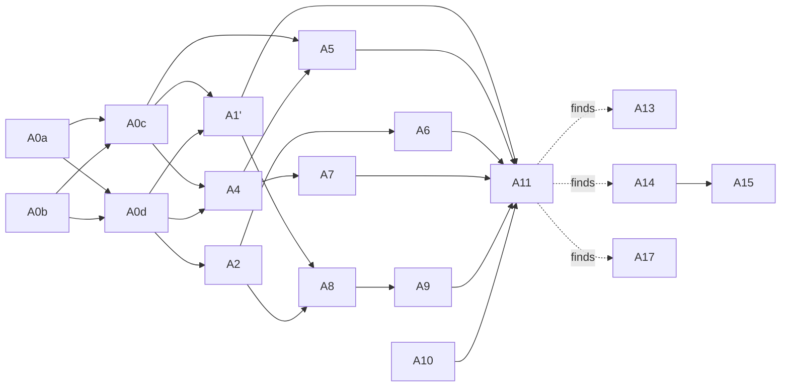

# Automations tickets

Spec: [../../automations.md](../../automations.md). Mattpocock-style vertical slices, **one ticket per session**; each starts with a failing test that asserts what the chat (or the status file / block / automations log) shows and ends with `pnpm ci:local` passing. No latency criteria. Tickets are claimed from this docs PR (#44); code lands on `feat/automations-v2` (draft PR #49, from `master@d056198`). The old code PR #45 (`feat/automations`) is closed.

Re-derived 2026-10-17 from the Spec (ADR-013..015: catch-up ≤ 24 h by fire key, monitor wakes after a miss, status block v1; ADR-016..020: trace every 已错过 instant, one-shot expiry after a miss, accepted read-back limit, agent-task catch-up wording, **agent task** rename with flag `automations.agentTasks`) and **`master@d056198`** (link-recovery #47 merged: Outbox, FeishuLink, default idle bound and "no Continuations" are now on master, so no ticket waits on #47). Every file:line anchor in the tickets was checked against `d056198`. Old A1 (tracer) is split into A0b/A0c/A0d/A1'; old A3 (missed, no catch-up) is replaced by A0c.

| Ticket | Title | Blocked by (tickets) | Status |
|---|---|---|---|
| [A0a](A0a-schedule-pure-functions.md) | Schedule pure functions (grammar, floors, next fires, miss rule, catch-up plan incl. each missed instant) | — | ready |
| [A0b](A0b-store-and-flag.md) | Store (never-reused ids, creation fields, started fire keys, drafts), `automations` settings, automations log, CONTEXT glossary + `isBotOwner` | — | ready |
| [A0c](A0c-scheduler-catch-up.md) | Scheduler + fake clock + fire-key idempotency + catch-up ≤ 24 h + missed trace (injected sender / notifier / wake) | A0a, A0b | ready |
| [A0d](A0d-auto-new-confirm-card.md) | `/auto new` + signed confirm card (NoticeActionAuth-style, `auto.*` route) | A0a, A0b | ready |
| [A1'](A1p-delivery-via-outbox.md) | Reminder + missed-notice delivery via Outbox (per-fire journal entry); missed on link down; catch-up on recovery | A0c, A0d | ready |
| [A2](A2-recurring-creation-and-expiry.md) | Recurring creation, scripted end card, expiry | A0d | ready |
| [A4](A4-board-card.md) | Board + Pause/Delete + 已错过 rows + status block v1 (`id`/`paused`/`updatedAt`) | A0c, A0d | ready |
| [A5](A5-monitor-hook.md) | Monitor hook contract + local wake CLI subcommand | A0c, A4 | ready |
| [A6](A6-natural-language-creation.md) | Natural-language creation | A2 | ready |
| [A7](A7-lifecycle-and-observability.md) | Bot removed / chat disbanded (events + not-in-chat class), DM, observability | A4 | ready |
| [A8](A8-agent-task-run.md) | Agent task: own executor path, fresh session, result post, thread follow-up | A1', A2 | ready |
| [A9](A9-agent-safety-whitelist.md) | Agent-task safety: per-run bot-only identity, whitelist, `policy-guard` | A8 | ready |
| [A10](A10-backfill-skip-non-chat-scopes.md) | Backfill skips `auto:`/`meeting:` scopes (F20) | — | ready |
| [A11](A11-e2e-bot-arena.md) | E2E in Bot Arena (controller) | A0a–A10 | ready-for-human |
| [A13](A13-cards-schema2.md) | **Blocker:** automation cards in CardKit schema 2.0; card-create failure visible, no silent draft | — | ready-for-agent |
| [A14](A14-agent-result-body.md) | Agent result post uses the shared final-reply extraction (`finalText`) | — | ready-for-agent |
| [A15](A15-notice-wording-and-trigger-source.md) | Cross-day 原定 labels, accurate `triggerSource`, no 追问 footer on interrupted/policy-guard notices | A14 | ready-for-agent |
| [A17](A17-oneshot-confirm-and-grok-eos.md) | One-shot confirm card omits monthly frequency; Grok control-token-only text counts as empty | — | ready-for-agent |

## Start order on `feat/automations-v2` (PR #49)

- **Now:** A0a, A0b, A10.
- **After A0a + A0b:** A0c, A0d.
- **After A0c + A0d:** A1', A2, A4; then A5 after A4, A7 after A4, A6 after A2.
- **After A1' + A2:** A8 → A9.
- **Last:** A11.
- **From the first A11 run (2026-10-18):** A13 and A14 now (in parallel), A15 after A14; then rerun the A11 scenarios each ticket lists.
- **From the A11 run on `91b9dec`:** [A17](A17-oneshot-confirm-and-grok-eos.md) (one-shot confirm frequency, Grok `<|eos|>` empty result); then rerun the scenarios that ticket lists.

Reminders ship after A0a–A1', A2, A4, A5, A7. Agent tasks (`automations.agentTasks`, default off) ship after A8–A9.

Out of this repo: fixing larkent-monitor so misses stop happening is separate follow-up work (spec, Resolved decisions 6).

## Blocking graph

