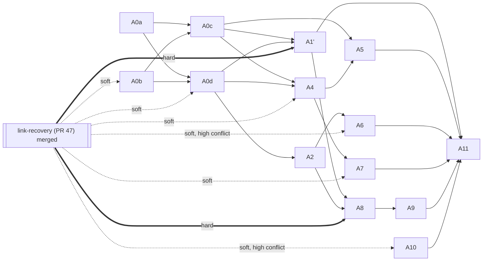

# Automations tickets

Spec: [../../automations.md](../../automations.md). Mattpocock-style vertical slices, **one ticket per session**; each starts with a failing test that asserts what the chat (or the status file / block) shows and ends with `pnpm ci:local` passing. No latency criteria. Code lands on `feat/automations` (PR #45).

Re-derived 2026-10-17 from the Spec (ADR-013..015: catch-up ≤ 24 h by fire key, monitor wakes after a miss, status block v1) and `master@426f670`. Old A1 (tracer) is split into A0b/A0c/A0d/A1'; old A3 (missed, no catch-up) is replaced by A0c.

**#47 dependency** (link-recovery, still open). Stated as behaviour/contract only, never as #47 code details:
- **none** — no #47 contract involved; start now.
- **soft** — no behavioral dependency, but overlaps code #47 reshapes; may start now (or should wait, where marked "high conflict") and rebase after #47 merges.
- **hard** — needs a #47 contract (Outbox, FeishuLink up/down + recovered, default idle bound, no Continuations) to exist on master; blocked until #47 merges.

| Ticket | Title | Blocked by (tickets) | Depends on #47 | Why |
|---|---|---|---|---|
| [A0a](A0a-schedule-pure-functions.md) | Schedule pure functions (grammar, floors, next fires, miss rule, catch-up plan) | — | none | Pure, injected clock |
| [A0b](A0b-store-and-flag.md) | Store (never-reused ids, started fire keys, drafts) + flags | — | soft | Additive profile settings next to the reliability settings #47 reshapes |
| [A0c](A0c-scheduler-catch-up.md) | Scheduler + fake clock + fire-key idempotency + catch-up ≤ 24 h + local wake entry core | A0a, A0b | none | Sender and link-recovered signal are injected |
| [A0d](A0d-auto-new-confirm-card.md) | `/auto new` + signed confirm card | A0a, A0b | soft | Shares the signing base with notice actions #47 turns into Continuations |
| [A1'](A1p-delivery-via-outbox.md) | Reminder delivery via Outbox; missed on link down; catch-up on recovery | A0c, A0d | **hard** | Outbox + FeishuLink contracts |
| [A2](A2-recurring-creation-and-expiry.md) | Recurring creation, scripted end card, expiry | A0d | none | — |
| [A4](A4-board-card.md) | Board + Pause/Delete + status block v1 (`id`/`paused`/`updatedAt`) | A0c, A0d | soft | Refresh after recovery uses the #47 recovered signal once merged |
| [A5](A5-monitor-hook.md) | Monitor hook contract + local wake entry | A0c, A4 | none | Triggers the scheduler; real delivery from A1' |
| [A6](A6-natural-language-creation.md) | Natural-language creation | A2 | soft (high conflict) | Final-reply path is rerouted through the Outbox by #47; wait |
| [A7](A7-lifecycle-and-observability.md) | Bot removed / chat gone, DM, observability | A4 | soft | "Not in chat" classification uses #47's error classifier |
| [A8](A8-agent-kind-run.md) | Agent kind: fresh session, result post | A1', A2 | **hard** | Outbox result post, default idle bound, no Continuations |
| [A9](A9-agent-safety-whitelist.md) | Agent safety: bot-only identity, whitelist | A8 | **hard** (via A8) | Extends run outcome |
| [A10](A10-backfill-skip-non-chat-scopes.md) | Backfill skips `auto:`/`meeting:` scopes (F20) | — | soft (high conflict) | #47 rewrites backfill session-chat discovery; wait |
| [A11](A11-e2e-bot-arena.md) | E2E in Bot Arena (controller) | A0a–A10 | **hard** (via A1', A8) | — |

## Start order on `feat/automations` (PR #45)

- **Now:** A0a (none), A0b (soft, low conflict).
- **After A0a + A0b:** A0c (none), A0d (soft).
- **After A0c + A0d:** A2 (none), A4 (soft); then A5 (none) after A4.
- **After A4:** A7 (soft; the rejection path can wait for #47).
- **After #47 merges:** A1', A6, A10, then A8 → A9, then A11.

Reminder ships after A0a–A1', A2, A4, A5, A7. Agent kind ships after A8–A9.

## Blocking graph

