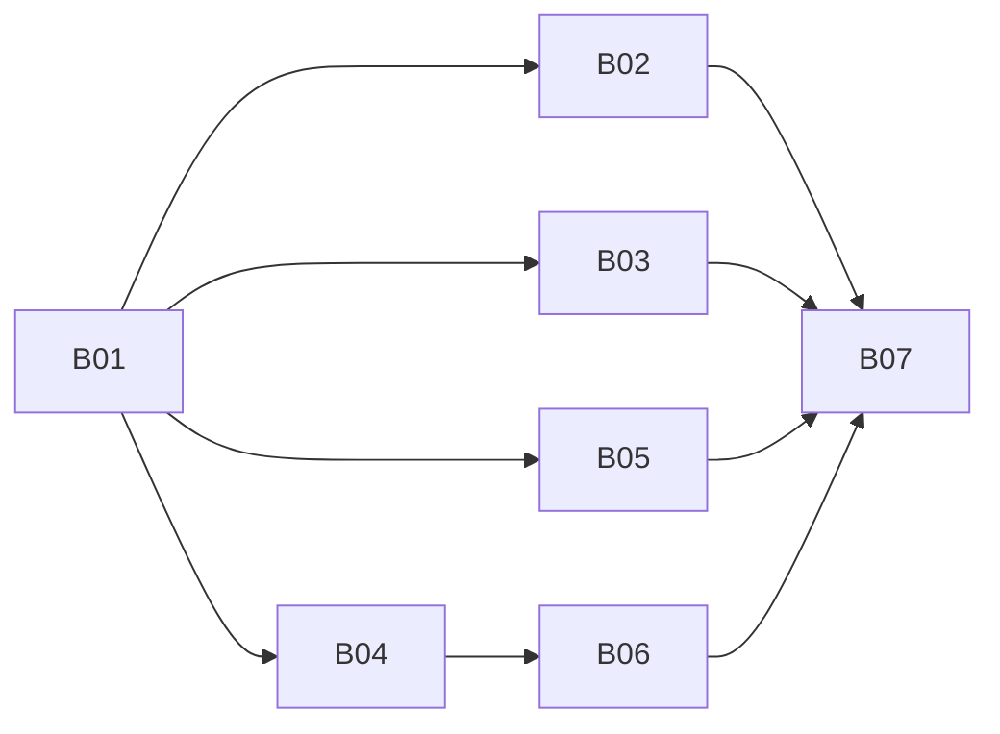

# Bridge skills tickets

Spec: [../../bridge-skills.md](../../bridge-skills.md). Mattpocock-style tracer-bullet vertical slices ([to-tickets](https://github.com/mattpocock/skills)), **one ticket per session**. Each code ticket starts with a failing behaviour test at the `startChannel` seam or the skill module's interface (or a skill contract test), and ends with `pnpm ci:local` passing in that worktree. Tickets are claimed read-only from this docs PR; code is pushed only to `feat/bridge-skills`. File:line anchors were checked against `master@953e7bd`.

| Ticket | Title | Blocked by | Status |
|---|---|---|---|
| [B01](B01-skill-module-and-automations.md) | Tracer bullet: skill module (list catalog / read skill, injected skill root, tool table, gating) + `<bridge_skills>` catalog on IM turns + `automations` migrated as the first skill; shipped in the package; contract and guard tests | — | ready-for-agent |
| [B02](B02-rejection-feedback.md) | Automations skill: reason codes on every verdict; per-scope rejection record; injected once on the next human turn with the skill's fix text (generic for reply-directive tools) | B01 | ready-for-agent |
| [B03](B03-no-card-promise-on-rejection.md) | Automations skill: rejected / refused / unknown-id lines say 未生成确认卡; kind-aware 「可写成」; reply wording stops mentioning the card | B01 | ready-for-agent |
| [B04](B04-lark-cli-skills.md) | `lark-cli` + `lark-user-identity` skills replace the system-prompt sections and `BRIDGE_AGENT_INSTRUCTIONS`; catalog on agent-task, comment and meeting prompts | B01 | ready-for-agent |
| [B05](B05-interactive-card-skill.md) | `interactive-card` skill replaces the system-prompt card callback section | B01 | ready-for-agent |
| [B06](B06-comment-and-meeting-skills.md) | `doc-comment` + `meeting-reply` skills replace the rule text in those prompt builders; inventory (Spec D7) closed | B01, B04 | ready-for-agent |
| [B07](B07-e2e-three-clis.md) | E2E on the test bridge across Grok Build, Antigravity CLI, Cursor CLI | B01–B06 | ready-for-human |

## Start order on `feat/bridge-skills`

The frontier after B01 is B02–B05, but they share files (settle path, IM prompt assembly, system prompt), so run them **serially** on the shared branch:

- **Now:** B01.
- **Then:** B02 → B03 (automations skill) → B04 → B05 → B06.
- **Last:** B07, then a normal merge of the code PR (no squash), then close this docs PR.

## Blocking graph

## Adding a skill later

Follow Spec D5: a pure-guidance skill is one new directory with a `SKILL.md` (no code); a tool-backed skill also needs its bridge tool (availability predicate shared with the settle path, validation in code). Write it as a new ticket against this Spec; the contract tests cover it automatically.
