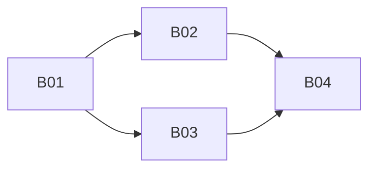

# Bridge skills tickets

Spec: [../../bridge-skills.md](../../bridge-skills.md). Mattpocock-style tracer-bullet slices ([to-tickets](https://github.com/mattpocock/skills)), **one ticket per session**. Each code ticket starts with a failing behaviour test at the `startChannel` seam or a doc-contract unit test, and ends with `pnpm ci:local` passing in that worktree. Tickets are claimed read-only from this docs PR; code is pushed only to `feat/bridge-skills`. File:line anchors were checked against `master@953e7bd`.

| Ticket | Title | Blocked by | Status |
|---|---|---|---|
| [B01](B01-automations-skill-and-index.md) | Tracer bullet: automations `SKILL.md` (full grammar, examples, recovery per reason code) + capability-gated skill index replaces `AUTOMATION_PROPOSAL_INSTRUCTION`; shipped in the package; doc-contract tests | — | ready-for-agent |
| [B02](B02-rejection-feedback.md) | Machine-usable rejection feedback: reason codes on every verdict (incl. refuse); per-scope record; injected once on the next human turn with the doc's fix text | B01 | ready-for-agent |
| [B03](B03-no-card-promise-on-rejection.md) | Rejected / refused / unknown-id lines say 未生成确认卡; kind-aware 「可写成」 examples; `SKILL.md` reply wording stops mentioning the card | B01 | ready-for-agent |
| [B04](B04-e2e-three-clis.md) | E2E on the test bridge across Grok Build, Antigravity CLI, Cursor CLI | B01, B02, B03 | ready-for-human |

## Start order on `feat/bridge-skills`

- **Now:** B01.
- **After B01:** B02, then B03 (B03 only depends on B01, but both touch the proposal settle path; run them serially on the shared branch to avoid conflicts).
- **Last:** B04, then a normal merge of the code PR (no squash), then close this docs PR.

## Blocking graph

